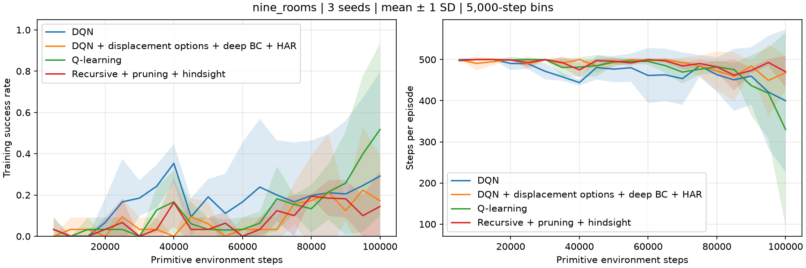
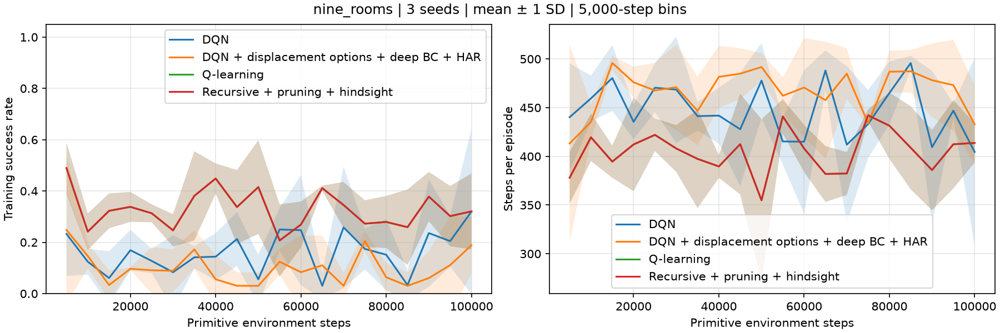

# Nine-room DQN comparison

Three seeds, 100,000 primitive training steps per method per seed; 100 frozen greedy evaluation episodes per seed. Sparse reward +1 at the goal, zero otherwise, 500-step time limit. Fixed task: (1,1) to (15,15). Random task: independently sampled distinct start and goal each episode. Both position and goal are observed.

DQN: two 64-unit ReLU hidden layers, Adam 0.001, Huber loss, replay capacity 50,000, batch 64, one update per four inserted transitions, target copy every 250 updates, gamma 0.99, epsilon 0.2. Neural inputs are normalized position and goal coordinates. Tabular methods observe the equivalent joint state ID.

Outcome discovery groups adjacent pairs of manager decisions from successful trajectories by physical endpoint displacement. The most frequent unseen nonzero displacement with at least three examples becomes an option every ten episodes, up to twelve. Each option uses a separate two-hidden-layer neural policy trained with cross entropy on the pooled demonstrations (150 minibatches, at most 256 samples each). Outputs include primitives and older options. Options initiate everywhere; they terminate at the invocation-relative displacement, their primitive-step bound, or their decision limit at a child boundary. An ancestor termination interrupts a child. Child references only point backward.

HAR matches deterministic neural option executions against successful primitive trajectories, retaining original task rewards and discounting by primitive duration. It adds at most 100 relabelled transitions per new option to manager replay. Ordinary manager updates also use discounted semi-Markov returns. Time limits bootstrap; reaching the goal does not.

## Fixed task

Mean ± sample standard deviation across seeds. Evaluation steps include failures at the time limit.

| Method | Greedy success | Greedy steps | Final training success | Options | HAR transitions | Max depth |
|---|---:|---:|---:|---:|---:|---:|
| DQN | 0.0 ± 0.0% | 500.0 ± 0.0 | 24.8 ± 40.8% | 0.0 ± 0.0 | 0.0 ± 0.0 | 0.0 ± 0.0 |
| Outcome DQN + BC + HAR | 0.0 ± 0.0% | 500.0 ± 0.0 | 18.8 ± 22.2% | 10.0 ± 3.5 | 869.3 ± 306.4 | 3.3 ± 1.5 |
| Q-learning | 52.0 ± 45.3% | 303.0 ± 241.0 | 41.2 ± 40.0% | 0.0 ± 0.0 | 0.0 ± 0.0 | 0.0 ± 0.0 |
| Earlier composed + pruned + HAR | 18.0 ± 9.8% | 471.0 ± 19.3 | 15.6 ± 8.3% | 11.7 ± 0.6 | 97.7 ± 15.0 | 1.3 ± 0.6 |

## Random task

Mean ± sample standard deviation across seeds. Evaluation steps include failures at the time limit.

| Method | Greedy success | Greedy steps | Final training success | Options | HAR transitions | Max depth |
|---|---:|---:|---:|---:|---:|---:|
| DQN | 0.7 ± 1.2% | 496.7 ± 5.7 | 21.7 ± 15.8% | 0.0 ± 0.0 | 0.0 ± 0.0 | 0.0 ± 0.0 |
| Outcome DQN + BC + HAR | 0.0 ± 0.0% | 500.0 ± 0.0 | 10.2 ± 11.5% | 12.0 ± 0.0 | 1071.3 ± 132.1 | 3.7 ± 1.2 |
| Q-learning | 30.7 ± 4.9% | 405.3 ± 23.1 | 32.2 ± 3.4% | 0.0 ± 0.0 | 0.0 ± 0.0 | 0.0 ± 0.0 |
| Earlier composed + pruned + HAR | 30.3 ± 4.6% | 408.0 ± 20.5 | 32.2 ± 3.4% | 3.0 ± 0.0 | 180.7 ± 10.1 | 1.0 ± 0.0 |

## Interpretation limits

These are modest-budget tests on one layout, without hyperparameter tuning. Equal environment steps do not imply equal compute: HAR inserts extra transitions and triggers extra gradient updates. The earlier method uses tabular cloning with state-specific initiation and pruning, so this is a method comparison rather than an isolated neural-cloning ablation. Fixed-task evaluation repeats one deterministic task; random-task evaluation covers 300 matched sampled tasks across the seeds. The training task streams match by episode index, while different episode lengths produce different numbers of observed tasks. A low success rate at this budget is not evidence of convergence. Timing includes overlapping jobs and should not be used to rank methods.
